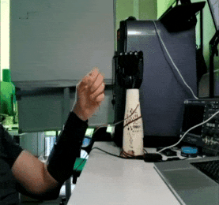
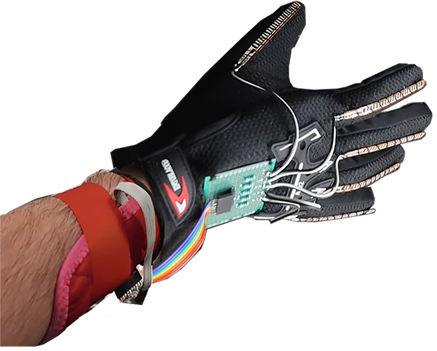
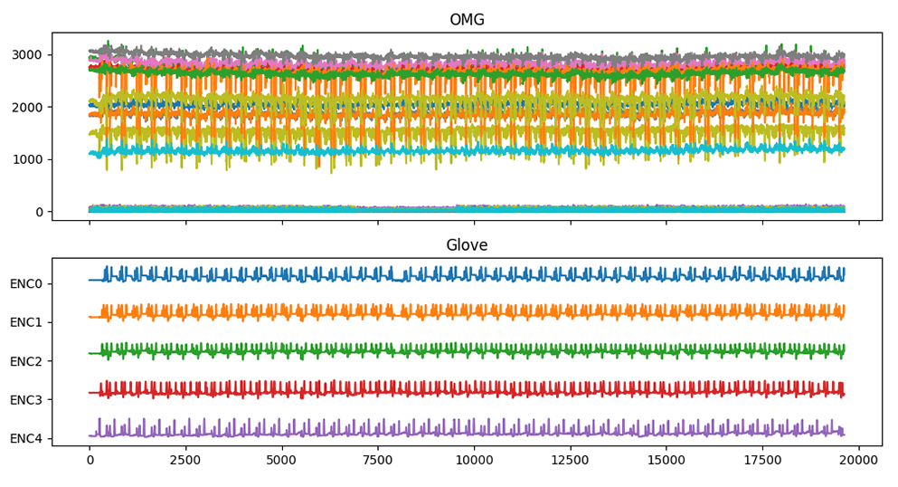
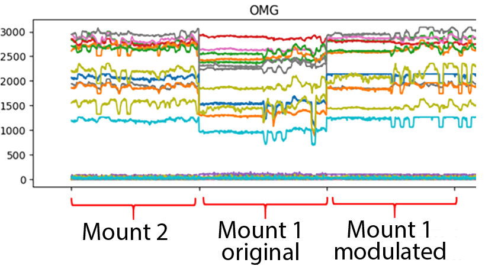
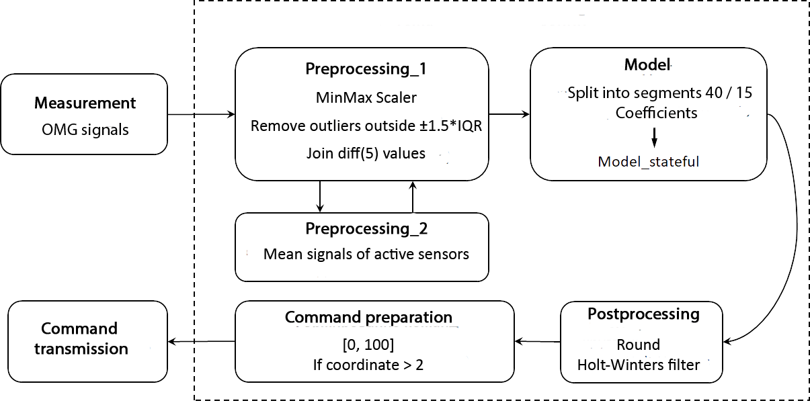
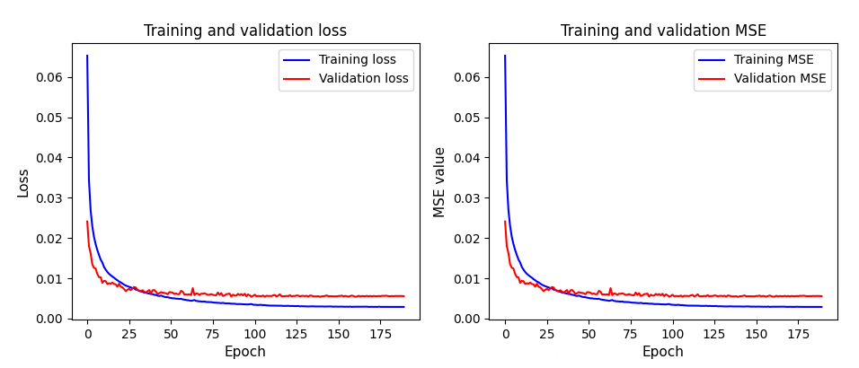
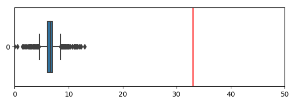
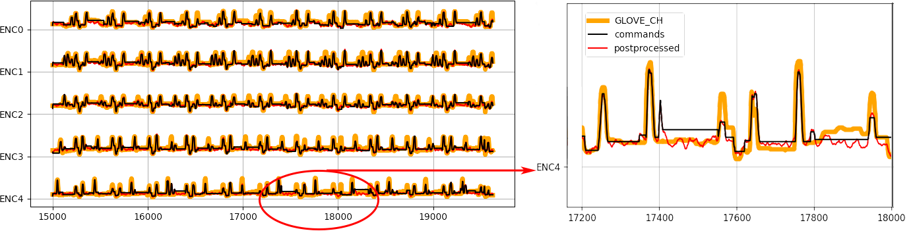
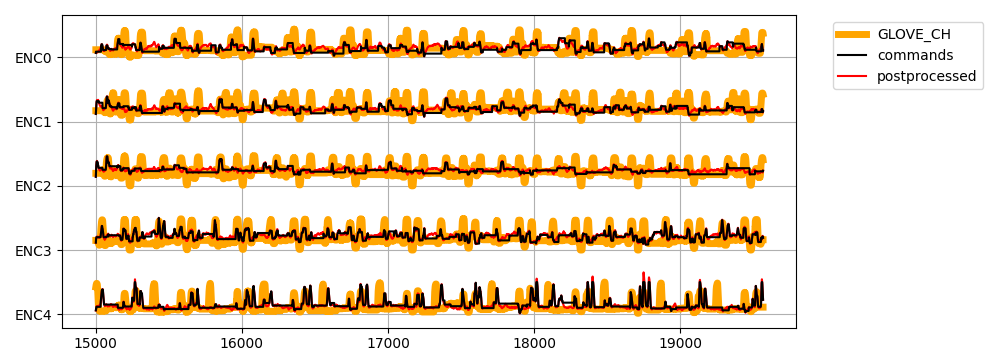

# Hand prosthesis automation


## Content

* [Summary](README.md#Summary)
* [Introduction](README.md#Introduction)
* [Data and methods](README.md#Data-and-methods)  
* [Results](README.md#Results)     
* [Adaplivity check](README.md#Adaplivity-check)
* [Conclusion](README.md#Conclusion)                    
* [Project structure](README.md#Project-structure)        


## Summary

A custom algorthm was developed to manage a bionic hand prosthesis using forearm muscle signals form optomyographic (OMG) sensors. The mean execution time of the program is $7\pm 1$ ms, which is about four time shorter than the aveage human reaction time. The core part of the algorithm is an LSTM neural network, which satisfactorily adapts to various hand gestures and different initial sensor position.

<p align="center">  </p>

## Introduction

A traumatic loss or damage of a person's hand significantly limits their ability to work in modern society. Even daily routine task, such as brushing teeth or grabbing a door handle, can become slower. Although passive or body powered prostheses may add some freedom, their grippers lack versatility, and their construction restricts fine movements. Furtheromore, actuation systems of these types of artificial limbs may cause discomfort. As a result, passive and semi-active devices still limit the work capacity of an impaired person. By contrast, bionic prostheses, which allow independent movement of individual fingers, are more compact, but could be considerably heavier because of accumulators. Nevertheless, their microcontroller-based actuating systems allow operators to perform a wider range of movements, which ensures a better user experience. 

Since each traumtic incident is unique, the variation in hand disabilities is relatively broad. In this study, we consider the case of traumatic palm loss without severe impairment of the forearm muscules responsible for finger movement. This biophysical condition is particularly suitable for rehabilitation using a non-invasive bionic hand prosthesis. 

From the engineering point of view, a bionic prosthesis can be represented as a combination of three main systems: mechanical, electrical, and operational. The last system is in our particular interest to us because the prosthesis must imitate a natural biophysical function, which is a difficult task for the following reasons. 

First, transmission of neural signals through human nervs occurs almost without delays. Any external system must be fast enough to ensure a positive user experience. Second, hand manipulation ususally involves different muscles, and each of them may change its state while performing a fine movement. Thus, the system must process a complex combination of muscle signals and output the coordinates of one or more fingers. Third, the location of muscules is unique for each forearm. Furthermore, the prosthesis has some flexibility when attached to the forearm, so it does not necessairy reach the same muscles after reattachment. This means the prosthesis sensors must detect muscle signals from certain areas of the forearm rather than from specific points. Taken these circumstances into account, the best solution for such a complex signal analysis task could be an AI-based algorithm.

Thus, the project goals can be formulated as follows. First, we must develop an automation algorithm for a bionic hand prosthesis that predicts finger coordinates based on the state of forearm muscles. Taken into account muscle movement under skin, the algorithm must be agnostic to different orienations of the forerm.

## Data and methods

The data aquisition procedure had certain limitations. The state of muscles can be recorded only from a person with healthy upper limbs. A disable person with an absent hand does not fit to this process because he or she cannot confirm what movements were performed. In addition, the experiment covers a set of gestures that humans most frequently do in everyday life such as gripping, opening the palm, stretching the index finger (a “pistol” gesture), uprising the thumb, etc. 

To simplify the upcoming analysis task, a standardized gesture protocol was created: an experimenter performed a repeatitive sequence of the most frequent gestures. Every 10 minutes he turned his palm so that its angle changed from $0$ degrees (parallel to the ground) to $90$ degrees (turned to the right), and $-90$ degrees (turned to the left). The total recording period was restricted to about 30 minutes, because the pilot gradually lost precision when performinh gestures.

Since the ground-truth data come from two different sources, namely the forearm and the hand, their states were recorded by two separate sensing devices working in pair. The muscle condition was estimated with a custom-made bandage with a number of OMG sensors. These 50-channel sensors precisely measured contraction or stretching of forearm muscles during hand movement at a frequency of 30.3 Hz. 

Another device, which was used to monitor hand gestures, looked like a glove carrying sensors of different types. Five *flex sensors* estimated the angles of every phalanges. Three *accelerometers* monitored the speed of fingers during gestures. *Gyroscopes* recorded the orienation of the palm. An analog of the glove is displayed in Fig. 1.

<p align="center">  </p>
<p align="center" style="font-size:14px"><i>Fig. 1 - An analog of the glove and the bandage with OMG sensors</i></p>

Following the recording, the data underwent some transformation for convenience. The raw data were originally recorded in a rare *.palm* format. Therefore, they were converted into the *.csv* format, which is a standard for such data analysis tasks, using the *Pandas* and the *MNE* open-source libraries. In addition, discrete digital signals from gyroscopes were transformed into the range from $-100$ to $+100$, while other signals - from $0$ to $100$. A sample of the resulting signals and finger coordinates is displayed in Fig.2.
 
<center>  </center>
<p align="center" style="font-size:14px"><i>Fig. 2 - OMG signals (above) and finger coordinates (below)</i></p>

During the analysis of raw signals we were provided with, there were multiple challenges:
* the signals amplitude of the same gestures changes over time. This might happen due to fatigue of the experimenter.
* fingers move together while performing most gestures. This dynamic behavior is caused by the natural structure of human hands and the inherited characteristics of ligaments.
* tension and relaxation of the forearm muscles during a gesture may occur unevenly over time. This may also be explained by the natural structure of human hand.
* it is difficult to repeat sensor installation when OMG sensors are placed on the same area of the forearm. The detection area is relatively small, whereas the muscle surface is uneven. As a result, it is hard to find the same muscle area.

These circumstances limit the direct combination of raw signals from different montages. Thus, we decided to modulate the frequency of the first montage before combining it with the second montage (see Fig. 3).  

<p align="center"> </p>
<p align="center" style="font-size:14px"><i>Fig.3 - Signals of the second monatges <br> before (center) and after (right) transformation</i></p>

## Results

To predict finger coordinates, we designed an algorithm that consists of four logical blocks:
* Signal preprocessing
* Coordinate prediction with the ML model
* Postprocessing of the prediction
* Command forming

Algorithm's scheme is shown in Fig.4.

<p align="center">  </p>
<p align="center" style="font-size:14px"><i>Fig.4 - Architecture of the algorithm</i></p>


# Preprocessing 

The data preprocessing includes several consecutive steps. On first, the raw signals need scaling to the range $r \in [0,1]$. The outliers falling outside the ranage of $\pm 1.5 \cdot IQR$ are  replaced with the boundary values. After this, the data array is combined with an array of descending differences differences between the current signal value and the value from five previous periods.

The combined array of preprocessed data is first divided into segments of 40 periods to avoid the model's learning the gestures protocol. Then the dataset was subdivided into training and test samples. 

###  Model training

Taking into account the nonlinear nature of OMG signals, we selected a neural network model, which are recommended itself as a perfect solution fir this task. To consider the data from previous periods, with an LSTM layers. The model architecture has shown a good convergence displayed in Fig. 5. The model weights saved separately.

<p align="center">  </p>
<p align="center" style="font-size:14px"><i>Fig.5 - Model training progress</i></p>

To speed up the prediction of our model after deployment on the prosthesis, we used two important methods. On firs, we selected a statefull model architecture, which buffers tensors. In addition, we transferred the training weights to the deployed model.

As a result, the total responce time of our algorithm, which was estimated for the 4628 test values, lies within the range of $7 \pm 1 \text {ms}$ that is almost four times shorter than our limit of $33 \text { ms}$. 

<p align="center">  </p>
<p align="center" style="font-size:14px"><i>Fig.6 - The inference time distribution</i></p>

The lack of experimental data and the requirement to use algorithms with a simple architecture caused that out model appeared quite sensitive, which affects the accumualtor charge of the prosthesis. In fact, the model was interpreting every minor change of muscle state as a movement of fingers. To elliminate this undesirable effect, we applied a Holt-Winters filter, which performes exponential smoothing of predicted coordinates according to the following formula:

$$s_{t}=s_{t-1} + \alpha \cdot(x_{t}-s_{t-1})$$ 

where: 
* $\alpha$ - a smoothing coefficient within the range $\alpha \in [0,1]$
* $s_{t}$ and $s_{t-1}$ - the coordinate value for the periods $t$ and $t-1$, respectively.

Tests have shown, that one filter is not enough to confront the oversensibility of the model. Thererfore, we added a new condition that allows movements if the predicted coordinate exceeds the previous value by at least 2 units. Although the measure has successfully elliminated the unwanted finger tremor, the system appeared to be less sensitive to slow movements. 

<p align="center">  </p>
<p align="center" style="font-size:14px"><i>Fig.7 - the Montage 2. Comparison between the coordinates: True vs predicted (left) vs filterd (right) </i></p>


## Adaplivity check

One of the tasks of the current study was to ensure the algorithm could adapt well to new motages of the prosthesis. In practice, it means the system must identify "active" sensors e.g. those detecting the current state of muscles more effectively. To implement this idea, we proposed following approach. Within every montage, we selected the first 20 sensors, whose average signal level exceeds 200 units, an arbitrary chosen value. The remaining "inactive" sensors outputed either relatively weak or constant signals. 

In order to match signals from different montages, we computed the overall average value across active sensors of the first montage. Thus, if the mean signal of a new montage differs from the original value, it will be adjusted using a coefficient. 

Overall, the proposed method showed satisfactory result on the second motage. The algorithm predicted movements fairly well for both fingers: the index and middle fingers, which are represented by ENC2 and ENC3 respectively. The predictions for the other fingers were comparatively worse, and their Mean Square Error value were higher.

<p align="center">  </p>
<p align="center" style="font-size:14px"><i>Fig.8 - Montage 1. Comparison between the coordinates: True vs predicted </i></p>

## Conclusion
This study explores an ai-based algorithm to automate the operation of a hand prosthesis. The algorithm's core is a machine learning models with an LSTM architecture. The system reacts relatively quickly, and it is adaptive to new positions of theprosthesis on the forearm.


## Project structure

<details>
  <summary>display project structure </summary>

```Python
├── .gitignore
├── config 
│   └── data_config.json            # configuration settings
├── data                            # raw data directory
│   ├── sprint3_pilote1_mount1_gestures.palm
│   └── sprint3_pilote1_mount2_gestures.palm
├── figures                         # figures directory
│   ├── fig_1_Glove_art.PNG
│   ├── fig_2.png
│   ├── fig_3_montage.png
│   ├── fig_4_shceme.png
│   ├── fig_5_outliers.png
│   ├── fig_6.png
│   ├── fig_7.png
│   ├── fig_8 commands.png
│   └── fig_9.png
├── models                          # models and weights
│   ├── MinMax_scaler.bin
│   └── model_LSTM.hdf5
├── notebooks                       # notebooks directory
│   └── Gestures_3.ipynb
├── README.md
└── utils                           # functions directory
    ├── config_reader.py
    ├── figures.py
    ├── functions.py
    └── __pycache__
```
</details>